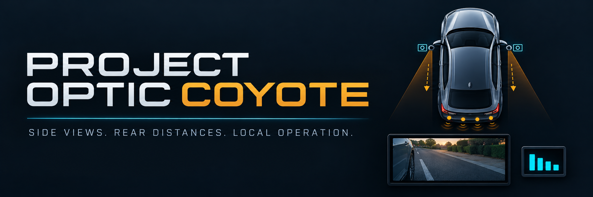

# Project Optic Coyote



**Blinker-selected side views. Reverse-activated rear distances. Local operation.**


*Conceptual banner artwork; camera views and sensing areas are illustrative.*

[Camera behavior](#side-cameras-that-follow-the-turn-signals) ·
[System connections](#system-connections) ·
[Installation](#hardware-and-setup) ·
[Documentation](#further-documentation)

Project Optic Coyote provides local side-camera views and rear-obstacle distance
readouts for a vehicle. Two exterior cameras serve the left and right blind-spot
views on an HDMI monitor; four rear-bumper ultrasonic sensors feed a separate
OLED display.

## Project highlights

- **Blinker-controlled camera views:** the left signal selects the left camera,
  and the right signal selects the right camera. Both cameras sit near the side
  mirrors and face rearward along the outside of the vehicle.
- **Continuous views through blink gaps:** the selected view remains visible
  through normal signal OFF intervals. Both-active hazard input stops camera
  capture and requests a black HDMI screen.
- **Reverse-controlled rear sensing:** qualified reverse activation starts the
  four rear sensors and their OLED distance view. Reverse deactivation stops
  acquisition and returns the OLED to its idle view, currently blank.
- **Readable distance values:** four fixed columns display feet as `0.0` through
  `9.9`, `≥10` for higher rounded values, and `-.-` for unavailable readings.
  Sensor numbers and a shared `ft` label remain visible.
- **Independent operation:** reverse sensing continues during left/right camera
  selection and hazards. Camera and OLED connection faults have separate recovery
  paths.
- **Local operation:** live video and sensor processing require no cloud service
  or network connection. The supplied camera pipelines do not record video.

## Side cameras that follow the turn signals

The left turn signal selects the left mirror-area camera, and the right turn
signal selects the right camera. Both face rearward along the outside of the
vehicle. Cameras remain powered while the system operates; the trigger changes
capture selection rather than switching camera power. Only one camera capture
runs at a time.

The following behavior applies when blinker trigger mode is enabled. Accepted
inputs have completed the configured debounce and, for a single side, settling
interval.

| Blinker condition | Camera and HDMI behavior |
| --- | --- |
| Trigger-mode startup | No camera capture; black output requested (`IDLE`) |
| Left signal accepted | Left camera selected (`LEFT`) |
| Right signal accepted | Right camera selected (`RIGHT`) |
| Both inputs inactive briefly | Previous LEFT, RIGHT, or BOTH state retained through the OFF gap |
| Both inputs active and accepted | Capture stops; black output requested (`BOTH`) |
| Both inactive beyond the configured hold | Capture stops; black output requested (`IDLE`) |
| GPIO monitoring exception | Capture stops; black output requested; restart required (`FAULT`) |

```text
Accepted LEFT or RIGHT --> Select the matching side camera
                                      |
                         Both inputs become inactive
                                      |
                   +------------------+------------------+
                   |                                     |
         Next pulse accepted                    OFF hold expires
         before hold expires                             |
                   |                                     v
         Continue/select view                 Stop capture; request black

Accepted BOTH ------------------------------> Stop capture; request black

Reverse activation --> Rear sensing and OLED operate independently
```

The OFF hold also retains BOTH through hazard OFF gaps. Its supplied one-second
value is provisional: installation tuning must allow the measured blink OFF gap,
qualification of the next pulse, and a sampling/scheduling margin. After turn
cancellation, the existing view remains until the hold expires.

Switching cameras interrupts video while the next capture starts. Black output
requires a functioning display pipeline; a display fault may leave an old frame
visible. Trigger handling is software control and provides no hardware interlock
or real-time cutoff guarantee.

The installation procedure enables blinker mode after configuration. The supplied
source configuration leaves it disabled until GPIO assignments are configured.
See [camera setup and trigger timing](docs/camera-setup.md#blinker-trigger-mode),
[protected blinker inputs](docs/project-wiring.md#optional-blinker-trigger-inputs),
and [simultaneous reverse/blinker operation](docs/combined-triggers.md).

## System connections

These diagrams summarize signal and data paths. Power, ground, protection,
connector assignments, and component verification requirements are specified in
the [complete wiring guide](docs/project-wiring.md).

```text
SIDE-CAMERA PATH

Left mirror camera  --AHD--> USB capture 1 --+
                                             +--> Powered USB hub --> Pi
Right mirror camera --AHD--> USB capture 2 --+                          |
                                                                     HDMI
                                                                      |
                                                                      v
                                                                 HDMI monitor

Left/right blinkers --> Protected 3.3 V inputs --> Pi camera selector


REAR-DISTANCE PATH

Reverse signal --> Protected 3.3 V input --> Pi reverse bridge

Four rear sensors --I2C--> TCA9548A --I2C--> Sensor Nano
                                               |
                                              USB
                                               |
                                               Pi
                                               |
                                              USB
                                               |
                                          Display Nano --I2C--> OLED
```

The Pi is the USB host for both Nanos and the capture interfaces. The camera
selector drives HDMI; the reverse bridge manages rear sensing and the separate
OLED. Reverse sensing continues during left/right selection and hazards. These
software functions remain subject to shared power and USB hardware failures.

**Vehicle voltage must never connect directly to Pi GPIO.** All three vehicle
signals require suitable protected, 3.3 V-compatible sensing interfaces. Cameras
and Nanos require continuous, correctly rated supplies independent of blink
pulses and reverse activation.

## Rear distances at a glance

Qualified reverse activation starts rear ranging and the OLED distance view.
Reverse deactivation stops acquisition and returns the OLED to its idle view,
currently blank. Four fixed columns show feet as `0.0` through `9.9`, `≥10` for
higher rounded values, and `-.-` for unavailable readings.


*Host-rendered framebuffer example; physical OLED readability and viewing distance
remain unverified. The banner's display graphics are conceptual.*

Left and right refer to the vehicle facing forward. All four bumper sensors
face directly rearward, and their OLED columns remain in this physical order:

| Sensor | Rear-bumper position |
| --- | --- |
| 1 | Far left |
| 2 | Left-middle |
| 3 | Rear-middle |
| 4 | Far right |

Rear sensors indicate rear obstacles; they do not select side cameras or
establish side blind-spot clearance.

See [OLED behavior and sensor identities](docs/oled-display.md) and
[reverse activation and timing](docs/reverse-trigger.md) for details.

## Hardware and setup

The target assembly uses a Raspberry Pi 5 with 4 GB RAM, two AHD cameras with
compatible USB capture adapters, an HDMI monitor, and two ATmega328P Nano boards.
One Nano reads the four ultrasonic sensors; the other drives a 128×32 OLED.
The documented OS target is Raspberry Pi OS Lite 64-bit, Debian 13 Trixie.

1. Follow the [Pi setup guide](docs/rpi5-setup.md) and
   [installation package guide](docs/installation-package.md).
2. Check the [wiring and power requirements](docs/project-wiring.md), including
   protected vehicle-signal inputs. Vehicle voltage must not connect directly
   to Pi GPIO.
3. Configure [side cameras and blinkers](docs/camera-setup.md) and
   [reverse sensing](docs/reverse-trigger.md).
4. Complete the [combined-operation checks](docs/combined-triggers.md) and
   [OLED setup checks](docs/oled-display.md) before vehicle operation.

An [optional Pi buzzer](docs/pi-buzzer.md) supports explicit sound commands;
it is disabled by default and has no automatic reverse or blinker binding.

## Further documentation

The [documentation index](docs/index.md) organizes installation, operation,
diagnostics, wiring, and technical references.

| Task | Documentation |
| --- | --- |
| Prepare the Pi and install the software | [Pi setup](docs/rpi5-setup.md) · [Installation package](docs/installation-package.md) |
| Configure side views and blinkers | [Camera setup](docs/camera-setup.md) |
| Configure reverse sensing and interpret the OLED | [Reverse trigger](docs/reverse-trigger.md) · [OLED display](docs/oled-display.md) |
| Identify connections and sensor interfaces | [Project wiring](docs/project-wiring.md) · [Component pinouts](docs/component-pinouts.md) · [Ultrasonic sensing](docs/ultrasonic-sensing.md) |
| Check concurrent operation and diagnose faults | [Combined operation](docs/combined-triggers.md) · [Camera diagnostics](docs/camera-diagnostics.md) · [Reverse diagnostics](docs/reverse-diagnostics.md) |
| Adjust configuration, inspect firmware/code maps, or run tests | [Development guide](docs/development.md) |
| Inspect release artifacts and source status | [Release notes](docs/release-notes-v0.5.2-beta.md) · [Current source status](docs/current-state.md) |

## Source and release status

The current release is **v0.5.2-beta**. Its Debian package and offline installer
include the updated two-camera Pi software and documentation. The complete source
archive includes the rear-sensor and OLED Nano firmware, which is deployed
separately. See the [release notes](docs/release-notes-v0.5.2-beta.md) for artifacts
and verification, and [current source status](docs/current-state.md) for details.

Software tests and firmware compilation do not establish physical camera,
sensor, electrical, or display performance. Hardware acceptance remains pending.
Camera orientation, acoustic coverage, protected vehicle inputs, USB contention,
switching latency, and physical display readability require hardware acceptance;
the banner and text diagrams do not establish those properties.
