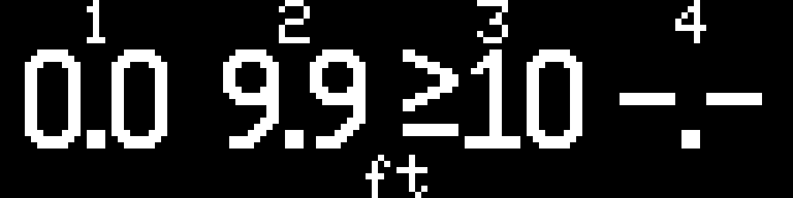

# Rear-bumper OLED display through Raspberry Pi USB

[Documentation index](index.md) | [Project overview](../README.md)

For the complete assembly, use the [project wiring scheme](project-wiring.md)
and [controller/module pinouts](component-pinouts.md). This guide covers the
display path's installation and operation.

The installed USB host is the **Raspberry Pi 5 with 4 GB RAM**.

Both supplied Nano builds default to **reverse-triggered operation**. Follow the
[reverse-trigger guide](reverse-trigger.md) to upload both sketches, configure
the Pi GPIO, and run the bridge with `--reverse-config`. Sensors remain idle and
the powered OLED remains blank outside a qualified reverse session. The idle
renderer is available for future non-reverse content.

The untagged CSV/D commands and continuous forwarding examples below describe
**standalone mode only**. To use those examples, set `OPTIC_COYOTE_STANDALONE` to
`1` in both Nano `reverse_config.h` files and rebuild/upload both sketches.
Do not mix standalone firmware or bridge operation with reverse mode.

The four rear-bumper sensors appear as **1, 2, 3, 4 from left to right** on a
0.91-inch SSD1306 **128x32 I2C** OLED. Each available distance is rounded to one decimal
place in feet, with rounded values above 9.9 shown as `≥10`. For example, 305, 610, 914, and 1219 mm display as:

```text
      1       2       3       4
     1.0     2.0     3.0     4.0
                 ft
```

The display uses these three forms:

| Input state | Visible value |
| --- | --- |
| Valid rounded distance from 0.0 through 9.9 feet | One decimal, without a leading space |
| Valid rounded distance greater than 9.9 feet | `≥10` |
| Missing, failed, invalid, or stale measurement | `-.-` |

Zero remains `0.0`; it is not a fault marker. The cap is applied **after rounding**:
3032 mm displays `9.9`, while 3033 mm displays `≥10`. Thus `≥10` denotes the
rounded display category, not a claim that the raw distance is at least 3048 mm.
Validity is checked first: only 0..30000 mm is accepted as a measurement;
`-1` is the unavailable sentinel. Raw millimetres, alarms, logging, and USB frames
are unchanged. Malformed packets are rejected atomically and do not refresh
freshness; existing valid values remain until their established timeout expires.

There is no scrolling or alternating between sensors. The label stays above its
fixed column; numbers never reorder themselves by distance.

### Fixed pixel layout

| Element | Position and size |
| --- | --- |
| Sensor labels 1–4 | Default small font, visible rows 0–6; x = 13, 45, 77, 109 |
| Distance values | Custom 9×16 digit and `≥` glyph cells, rows 8–23 |
| Decimal point | 3-pixel width within the same 16-pixel row; 3×3 visible dot |
| Shared `ft` footer | Default small font at x = 58, y = 25; visible rows 25–31 |
| Column boundaries | Four 32-pixel columns starting at x = 0, 32, 64, 96 |

Each value is centered by its glyph width, with one pixel between glyphs.
Decimal and unavailable values occupy 23 pixels, starting four pixels into the
column; `≥10` occupies 29 pixels, starting one pixel into the column. Integer
centering leaves the extra margin pixel on the right. Rows 7 and 24 remain clear.
The fixed font size does not change with distance. The full framebuffer is cleared
before each changed view, preventing residual pixels when field widths shrink.

The glyph rows and geometry are defined in
[distance_glyphs.h](../optic_coyote_display/distance_glyphs.h). The bitmaps reside
in AVR program memory, without a heap allocation for the font. A private `>`
render token selects the complete `≥` bitmap; it is neither a USB protocol value
nor text printed using the default font. The formatter and cached fields retain
five-byte buffers, with both unused bytes zeroed for deterministic comparisons.

The following image is an 8× nearest-neighbor enlargement of the host test
framebuffer for `0.0`, `9.9`, `≥10`, and `-.-`. It illustrates the raster layout;
it does not establish physical OLED visibility or viewing distance.



Reverse qualification, independent acquisition/display leases, stale-data timing,
release on LOW, hazard behavior, and simultaneous reverse/blinker operation are
unchanged. An active reverse session without fresh readings displays four `-.-`
fields. Freshness is checked before drawing and again before an OLED transfer.
If data expires while glyphs are drawn, the pending numeric frame is replaced
with `-.-`. Lease expiry takes priority and selects the idle renderer, currently
blank. A transfer already underway cannot be recalled; expiry during that
transfer is reflected at the next scheduled refresh. Explicit standalone mode uses the same glyphs and formatting, with its
existing per-sensor freshness limitation described below.

## Hardware roles and files

```text
Rear sensors 1  2  3  4 (leftmost to rightmost)
             |  |  |  |
TCA9548A     0  1  2  3
                  |
                 I2C
                  |
Sensor ELEGOO Nano (ATmega328P + CH340, existing firmware)
                  |
         USB-C to USB-A data cable
                  |
Raspberry Pi 5 (4 GB) USB host running rpi-oled-bridge/bridge.py
                  |
         another USB-A to USB-C data cable
                  |
Display ELEGOO Nano (same ATmega328P board type, new firmware)
                  |
          A4/SDA and A5/SCL
                  |
         SSD1306 128x32 OLED
```

Both microcontrollers plug into separate Pi USB host ports. The Pi reads one USB
serial device and writes to the other. No direct Nano-to-Nano USB connection,
network service or Pi I2C connection is used by the USB data path. Reverse mode
also uses one protected Pi GPIO input; standalone forwarding uses no GPIO.
Use data-capable cables with connectors matching the actual boards.

| Component | Program | Where to adjust it |
| --- | --- | --- |
| Sensor Nano | [Existing ultrasonic sketch](../optic_coyote_ultrasonic/optic_coyote_ultrasonic.ino) | Existing `Config` polling and sensor settings. |
| Pi | [bridge.py](../rpi-oled-bridge/bridge.py) | CLI USB paths, `--sensor-order`, `--stale-seconds`, `--boot-seconds`; timing constants at the top. |
| Display Nano | [New display sketch](../optic_coyote_display/optic_coyote_display.ino) | `Config` OLED address, landscape rotation, and timeout. |
| Distance glyphs | [distance_glyphs.h](../optic_coyote_display/distance_glyphs.h) | Flash-resident glyph rows, widths, spacing, and vertical position. |
| Display protocol | [display_protocol.h](../optic_coyote_display/display_protocol.h) | Bounded input parsing and integer conversion to tenths of a foot. |
| Reverse control | [reverse_control.py](../rpi-oled-bridge/reverse_control.py), [reverse.json](../rpi-oled-bridge/reverse.json) | GPIO qualification, session freshness, ownership, and fault recovery. |
| Reverse diagnostic | [diagnose_reverse.py](../rpi-oled-bridge/diagnose_reverse.py), [test procedure](reverse-diagnostics.md) | Software checks and optional GPIO/USB observations; controller ACKs do not verify OLED pixels. |
| Reverse firmware | [sensor settings](../optic_coyote_ultrasonic/reverse_config.h), [display settings](../optic_coyote_display/reverse_config.h), [display protocol](../optic_coyote_display/reverse_protocol.h) | Default idle boot, acquisition/display leases, and explicit release. |

Standalone forwarding consumes the **ultrasonic** Nano's CSV. A different optical
sensor controller would need to produce the same CSV format or have an explicit
parser added; this implementation does not guess another device's protocol.
The two-camera blinker selector retains its separate interface. The GPIO camera-warning draft is retired.

## Sensor order

The default bridge mapping is the order of the four distance columns, independent
of their labels or the `nearest_zone` alarm field:

| Screen position | Rear-bumper sensor | Default mux channel | CSV column label |
| --- | --- | --- | --- |
| Leftmost | 1 | 0 | `rear_far_left_mm` |
| Second | 2 | 1 | `rear_left_middle_mm` |
| Third | 3 | 2 | `rear_middle_mm` |
| Rightmost | 4 | 3 | `rear_far_right_mm` |

All four sensors face directly backwards from the rear bumper: 1 far left,
2 left-middle, 3 rear-middle, and 4 far right. Left and right refer to the vehicle
facing forward. Label cables 1-4 and verify each numbered OLED column with a
target at that physical sensor. CSV headers use these rear-position names; the
bridge also accepts older headers by column position for standalone compatibility.

### Preserve physical sensor identities

`Config::kMuxChannels` in the sensor firmware maps physical sensors 1-4 to mux
channels. Correct reversed or crossed cabling there, or correct the wiring, so
packet slots, CSV labels, `nearest_zone`, diagnostics, and OLED columns agree.
For example, if sensors 1, 2, 3, 4 connect to mux channels 3, 2, 1, 0, set
`kMuxChannels` to `{3, 2, 1, 0}` and rebuild/upload the sensor firmware. Keep
`kZoneLabels` in physical sensor order and the bridge order at `1 2 3 4`.

`--sensor-order` is a display-only permutation of packet slots in both modes.
It does not change firmware identities or CSV labels. For example,
`--sensor-order 4 3 2 1` puts slot 4 under OLED label 1; it is not a complete
correction for incorrectly mapped physical sensors. A foreground CLI override
also does not persist into the installed reverse service, which uses the default
order. Use the firmware mapping for the supported installation; retain this
CLI option only for an explicitly controlled display test.

## Connect the OLED to the display Nano

Wire with power removed. Use the pin **labels**, not a presumed physical pin
order; SSD1306 breakout layouts differ.

| Display Nano connection | OLED connection |
| --- | --- |
| A4 / SDA | SDA |
| A5 / SCL | SCL, sometimes labeled SCK on an I2C module |
| GND | GND |
| Supply appropriate for the exact breakout | VCC |

The Nano uses 5 V logic. Connect VCC to Nano 5 V and SDA/SCL directly **only if
the complete OLED breakout explicitly supports 5 V supply and I2C signals**.
The SSD1306 controller name alone does not establish this. For a 3.3 V-only
breakout, use a suitable 3.3 V supply and a bidirectional I2C level shifter with
pull-ups to the corresponding supply on each side. Keep a common ground.
Check the breakout's documentation for regulator, pull-ups, reset, and supply
requirements. Do not join the two Nanos' 5 V rails together with extra wiring.

The sketch defaults to 7-bit address **0x3C**, no separate reset pin, and normal
landscape orientation. Change `Config::kOledAddress` to `0x3D` if required by the
module's address setting. Set `kRotation` to `2` to turn the image 180 degrees.
The display Nano needs no TCA9548A because it has only one OLED on its I2C bus.

The implementation uses the [Adafruit SSD1306 library](https://github.com/adafruit/Adafruit_SSD1306)
and [Adafruit GFX](https://github.com/adafruit/Adafruit-GFX-Library).
Their [128x32 I2C example](https://github.com/adafruit/Adafruit_SSD1306/blob/master/examples/ssd1306_128x32_i2c/ssd1306_128x32_i2c.ino)
documents the dimensions and default address. That example does not establish
the electrical compatibility of an unidentified third-party breakout.

## Upload the display Nano

1. Install **Arduino AVR Boards** in Arduino IDE's Boards Manager.
2. Install **Adafruit SSD1306**, **Adafruit GFX Library**, and **Adafruit BusIO**
   through Library Manager, accepting their dependencies.
3. Open `optic_coyote_display/optic_coyote_display.ino`. Keep
   all supplied `.h` files, including `distance_glyphs.h`, in the same folder.
4. Select **Arduino Nano**, **ATmega328P**, and the display Nano's port. If the
   actual board uses the older bootloader, choose **ATmega328P (Old Bootloader)**.
5. Upload to the **display Nano**. Keep the ultrasonic sketch on the sensor Nano.

With Arduino CLI and the AVR core installed, run these from the repository root:

```sh
arduino-cli lib install "Adafruit SSD1306" "Adafruit GFX Library" "Adafruit BusIO"
arduino-cli compile --fqbn arduino:avr:nano:cpu=atmega328 optic_coyote_display
# Replace DISPLAY_PORT with the display Nano's real serial port.
arduino-cli upload --fqbn arduino:avr:nano:cpu=atmega328 --port DISPLAY_PORT optic_coyote_display
```

Use `arduino:avr:nano:cpu=atmega328old` for the old bootloader when needed.
Do not upload while the Pi bridge or Serial Monitor owns that port.

## Run the Pi bridge in standalone mode

Use Python 3.10 or newer and pySerial. The recommended Pi 5 (4 GB) baseline is
Raspberry Pi OS Lite (64-bit), Debian 13 Trixie. Complete the
[Pi setup guide](rpi5-setup.md) for OS installation and device permissions.
The [installation package](installation-package.md) also supplies the
`optic-coyote-reverse` command; its installed default is reverse-controlled
operation. The source command below documents standalone forwarding.
On Raspberry Pi OS:

```sh
sudo apt update
sudo apt install python3-serial
cd ~/ProjectOpticCoyote
python3 rpi-oled-bridge/bridge.py --list-ports
ls -l /dev/serial/by-id/ /dev/serial/by-path/
```

If installing offline, provision `python3-serial` from packages matching that Pi
OS beforehand. Runtime operation does not need a network connection. The bridge
uses [pySerial's timeout and exclusive-port APIs](https://pyserial.readthedocs.io/en/stable/pyserial_api.html).

Identify the two Nanos by plugging in one at a time and noting its device path.
Prefer unique `/dev/serial/by-id/` entries when present. Some CH340 boards have
no unique serial number; then use `/dev/serial/by-path/` to bind each role to a
particular physical USB port. Keep the cables in those same ports. Do not rely
on `/dev/ttyUSB0` remaining the sensor after unplugging or rebooting. The bridge
requires explicit role paths because identical adapters cannot safely be
distinguished by vendor/product IDs alone.

Replace both example paths with the actual values, then run:

```sh
python3 rpi-oled-bridge/bridge.py \
  --sensor-port /dev/serial/by-path/YOUR_SENSOR_NANO \
  --display-port /dev/serial/by-path/YOUR_DISPLAY_NANO
```

The Linux account needs permission to open both devices, normally membership in
`dialout`. If permission is denied, run `sudo usermod -aG dialout "$USER"`, then
log out and back in. Close Serial Monitor and any other process using either
port. The camera selector must not open either of these same serial devices.

The bridge stays in the foreground. Ctrl+C or SIGTERM requests shutdown, sends
`STOP` to the sensor and unavailable values to the OLED when possible, and closes
both ports. The [installation package](installation-package.md) supplies a
separate reverse-controlled service. Successful setup enables that service and
the camera service for boot without starting them immediately. This foreground
standalone command does not create a service; stop the installed reverse service
before using it to avoid competing for the same USB endpoints.

For a temporary display-only reversal or timing test (this does not correct
firmware sensor identities or configure the installed service):

```sh
python3 rpi-oled-bridge/bridge.py \
  --sensor-port /dev/serial/by-path/YOUR_SENSOR_NANO \
  --display-port /dev/serial/by-path/YOUR_DISPLAY_NANO \
  --sensor-order 4 3 2 1 --boot-seconds 2 --stale-seconds 2
```

## Standalone serial contract and failure behavior

This section applies only to the explicitly enabled standalone firmware and
bridge path. In reverse mode, OLED USB/ACK failures retry the display link while
qualified sensor acquisition continues; LOW still releases both functions.
The [reverse guide](reverse-trigger.md) defines its independent link recovery,
fresh display sessions, and per-sensor age checks.

Both links use **115200 baud, 8N1**, without flow control.

- **Sensor side:** the bridge waits two seconds after opening both ports,
  discards old input, and sends `START`. It repeats the idempotent command every
  two seconds so a sensor reset can recover without restarting the bridge.
  It accepts the existing eight-column CSV, including split USB reads.
- **Display side:** complete ASCII packets have the form
  `D,305,610,914,1219\n`. The four integers are millimetres, already arranged
  left to right by the Pi. Values must be `-1` or 0 through 30000. The display
  converts millimetres to feet using exactly 304.8 mm per foot and rounds once.
- **Rate:** the Pi keeps only the latest received snapshot and sends at most
  ten packets per second. Repeated values keep the display link alive but do
  not create new sensor readings. The OLED redraws changed text at most ten
  times per second.
- **No data:** startup, never-read sensors, and explicit `-1` values display
  `-.-`. A sensor stream silent for two seconds makes the Pi send four missing
  values. The display independently clears values after two seconds without a
  valid display packet, plus its next refresh interval. Invalid packets never
  refresh that timeout or partially update the screen.
- **Reconnection:** an open/read/write error closes both ports, discards the
  session's cached values, and retries every two seconds. Partial writes are
  treated as failed sessions. Leading newlines resynchronize frame boundaries.
- **OLED connection:** a missing I2C address is retried once a second. Wire has
  a 25 ms timeout for a stuck bus. Initialization/allocation or transfer failures
  are retried while serial continues to be serviced. A disconnected or frozen
  physical OLED cannot be guaranteed to show a fault message.

**Standalone per-sensor freshness limitation:** the standalone sensor firmware retains each
sensor's latest successful reading indefinitely. CSV does not include individual
ages or identify the sensor updated by each row. If one sensor fails while others
continue reporting, that sensor's previous value can remain displayed. The Pi
timeout detects a stopped entire stream only. This implementation preserves that
sensor protocol; it does not imply four newly measured values in every packet.
Reverse mode instead sends individual ages, marks failed/stale samples
unavailable, and rejects delayed or previous-session data.

## Verify before installation

Software checks from the repository root:

```sh
python3 -m unittest discover -s rpi-oled-bridge -p "test_*.py" -v
arduino-cli compile --fqbn arduino:avr:nano:cpu=atmega328 optic_coyote_display
g++ -std=c++11 -Wall -Wextra -Werror -I tests/display tests/display/test_display.cpp -o /tmp/optic-coyote-display-test
/tmp/optic-coyote-display-test
g++ -std=c++11 -Wall -Wextra -Werror -I tests/display tests/display/test_reverse_display.cpp -o /tmp/optic-coyote-reverse-display-test
/tmp/optic-coyote-reverse-display-test
```

On Windows with MinGW:

```powershell
g++ -std=c++11 -Wall -Wextra -Werror -static -I tests/display tests/display/test_display.cpp -o "$env:TEMP/optic-coyote-display-test.exe"
if ($LASTEXITCODE -eq 0) { & "$env:TEMP/optic-coyote-display-test.exe" }
```

The tests protect column order, decimal rounding, partial/malformed/oversized
frames, atomic updates, stale-stream behavior, reset/header handling, short
writes, port cleanup, millis rollover, and simulated OLED recovery. Host drawing
tests rasterize every supported decimal and special field in every column at
rotations 0 and 2,
reject out-of-screen pixel writes, check margins and separator rows, and verify
the equality bar in `≥`. Framebuffer comparisons cover width changes, startup,
stale data, recovery, full-scene 180-degree rotation, and release to blank idle.
Every accepted integer distance from 0 through 30000 mm is checked against exact
half-tenth rounding boundaries. Changes between raw measurements that share the
`≥10` category refresh data without unnecessary OLED transfers. Deterministic
drawing delays exercise stale-data and lease expiry before transfer, including
millis rollover and a previously displayed unavailable view. These are software checks;
they do not render through the physical display.

An optional argument to `/tmp/optic-coyote-display-test`, such as
`/tmp/optic-coyote-display-test /tmp/oled-layout.pbm`, exports the representative
128×32 framebuffer as a PBM image. The documentation preview is that image
enlarged by eight using nearest-neighbor sampling.

The reviewed layout revision passed both display C++ host harnesses with address
and undefined-behavior sanitizers, plus 141 Python tests (106 bridge/reverse and
35 integration). The display sketch compiled for
`arduino:avr:nano:cpu=atmega328` with 19488 bytes of program storage and 700 bytes
of static RAM. The SSD1306 framebuffer is allocated dynamically and is not
included in that static RAM figure. No device was flashed. Packages, offline
bundles, and installers have not been rebuilt for this revision.

### OLED source review

The review reproduced a freshness-boundary defect: a frame could begin drawing
while data was fresh and transfer numeric values after the data deadline.
`distancePacketFresh()` now supplies a common freshness check for rendering and
pre-transfer validation. The pending frame is invalidated and redrawn with
unavailable markers, even when the previous transferred frame already contained
those markers. Ownership is checked after the redraw so lease expiry still
selects idle. The new regression failed before this correction and passed after it.

No clipping, rounding, cap-token, sensor-slot, or reverse lease regression was
found in the reviewed paths. The host raster still matches the documented
preview exactly. Physical readability, GPIO/USB timing, and OLED transfer behavior
remain unverified. Packages and installers have not been rebuilt.

For a standalone OLED-only bench check, close the bridge, open the display Nano in Serial
Monitor at 115200, wait for reset, and send `D,305,610,914,1219` with a newline.
Expect `1.0 2.0 3.0 4.0` under labels 1-4. Values expire after two seconds unless
another packet arrives. Send `D,-1,0,5000,30000` to check `-.- 0.0 ≥10 ≥10`.
Then close Serial Monitor and start the Pi bridge.

On the assembled hardware, move an object in front of each rear sensor and
confirm the matching left-to-right column. Check measured distances, sensor
reset, display reset, Pi restart, each USB unplug/replug, and removal of the whole
sensor stream. Test a single sensor failure separately with the cache limitation
above in mind. Check actual readability, orientation, power, I2C levels, and
response time in the installation. Local compilation and simulated tests do not
establish any of those physical results.
